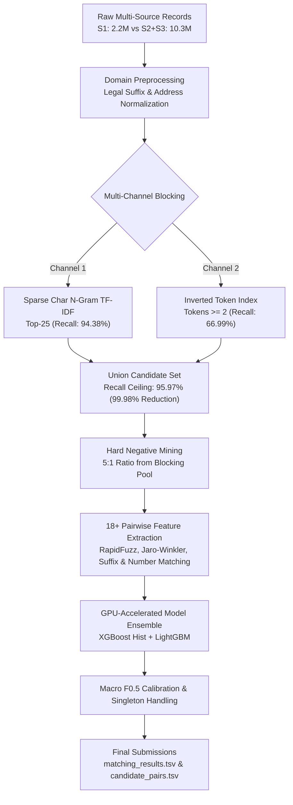

# 🏢 Amazon ML Challenge — Scalable Business Entity Resolution

[](https://www.python.org/downloads/)
[](https://xgboost.ai/)
[](https://lightgbm.readthedocs.io/)
[](https://github.com/maxbachmann/RapidFuzz)
[](https://opensource.org/licenses/MIT)

An end-to-end, high-performance machine learning pipeline built for the **Amazon ML Challenge 2026**. This project solves large-scale multi-source **Business Entity Resolution (Record Linkage / Deduplication)**, matching **2.2 Million Source 1 query entities** against a heterogeneous candidate pool of **10.3 Million business records** under strict evaluation on **Macro $F_{0.5}$ score**.

---

## 🌟 Key Highlights

- **Massive Scale:** Resolved entities across **12.5M combined records** (2.2M Source 1 vs 10.3M Sources 2 & 3), navigating a search space of $>22$ Trillion potential pairs.
- **Hybrid Multi-Channel Blocking:** Integrated Sparse Sublinear Character N-Gram TF-IDF and Inverted Token Overlap indexing to slash comparison volume by **99.98%** while maintaining a **95.97% Recall Ceiling**.
- **Domain-Specific Preprocessing:** Regex engine stripping **40+ legal business suffixes** (`Pvt Ltd`, `LLC`, `Corp`, `GmbH`, transliterated Indic forms) to isolate core corporate names and prevent artificial similarity spikes.
- **Precision Feature Engineering:** 18+ fuzzy syntactic, semantic, and structural signals (RapidFuzz Token Sort/Set ratios, Jaro-Winkler, Levenshtein, street number/PIN overlap, and legal compatibility flags).
- **Hard Negative Mining & Ensembling:** Mined hard negative pairs directly from blocking candidates (5:1 ratio) and ensembled GPU-accelerated **XGBoost** and **LightGBM** classifiers.
- **Macro $F_{0.5}$ Calibration:** Calibrated decision boundaries specifically for precision-heavy $F_{0.5}$ optimization ($\beta=0.5$), penalizing false business merges $2\times$ more than missed matches.

---

## 🏛 Pipeline Architecture



---

## 📊 Experimental Results

### Candidate Blocking Comparison (Validation Split)
| Channel | Candidate Strategy | Recall Ceiling | Reduction Ratio | Avg Candidates / Entity |
| :--- | :--- | :---: | :---: | :---: |
| **TF-IDF Channel** | Char 3–5 N-grams, Cosine $\ge 0.08$ | 94.38% | 99.99% | 25.0 |
| **Rule Channel** | Inverted Index, $\ge 2$ Shared Tokens | 66.99% | 99.98% | 1,987.5 |
| **Fused (Union)** | **Multi-Channel Fusion** | **95.97%** | **99.98%** | **2,005.9** |

---

## 📂 Repository Structure

```text
├── Documentation.md              # Detailed methodology and error analysis write-up
├── README.md                     # Project documentation and reproduction guide
├── requirements.txt              # Pinned Python package dependencies
├── .gitignore                    # Prevents tracking data, parquets, models, and temp files
│
├── notebooks/
│   ├── Amazon_ML_Challenge_Master.ipynb  # Unified, end-to-end master Jupyter Notebook
│   └── experiments/
│       ├── colab_blocking_experiments.ipynb  # Colab TF-IDF and rule blocking experiments
│       ├── colab_eda_preprocessing.ipynb     # Initial EDA and data inspection
│       └── kaggle_gpu_pipeline.ipynb         # Kaggle GPU training script
│
├── src/                          # Modular production pipeline
│   ├── __init__.py
│   ├── config.py                 # Hyperparameters, legal suffix patterns, paths
│   ├── preprocess.py             # Unicode cleaning, legal suffix removal, address parsing
│   ├── blocking.py               # Sparse TF-IDF and inverted token indexing
│   ├── features.py               # 18+ Pairwise similarity metrics (RapidFuzz, Jaro-Winkler)
│   ├── dataset.py                # Pair generation & hard negative sampling
│   ├── models.py                 # XGBoost + LightGBM GPU/CPU training & ensembling
│   ├── metrics.py                # Macro F0.5 computation & threshold calibration
│   └── pipeline.py               # Executable end-to-end pipeline runner
│
└── utils/
    └── validate_submission.py    # Official submission format checker
```

---

## ⚡ Quickstart & Replication

### 1. Clone & Set Up Virtual Environment
```bash
git clone https://github.com/saurabhduhariya/amazon-ml-challenge.git
cd amazon-ml-challenge

python3 -m venv venv
source venv/bin/activate
pip install -r requirements.txt
```

### 2. Dataset Setup
Place the challenge datasets into `student_resource/dataset/`:
```text
student_resource/dataset/
├── train/
│   ├── train_source1.tsv
│   ├── train_source2.tsv
│   ├── train_source3.tsv
│   └── train_ground_truth.tsv
└── test/
    ├── test_source1.tsv
    ├── test_source2.tsv
    └── test_source3.tsv
```

### 3. Run the Pipeline
To run the automated pipeline on a sample of 30,000 entities:
```bash
python3 -m src.pipeline --sample 30000
```

To run the interactive notebook, launch Jupyter:
```bash
jupyter notebook notebooks/Amazon_ML_Challenge_Master.ipynb
```

### 4. Validate Submission Files
Validate generated output files against official competition schema:
```bash
python3 utils/validate_submission.py \
    --matching output/matching_results.tsv \
    --candidate output/candidate_pairs.tsv \
    --test-dir student_resource/dataset/test
```

---

## 📄 License
This project is licensed under the [MIT License](LICENSE).
