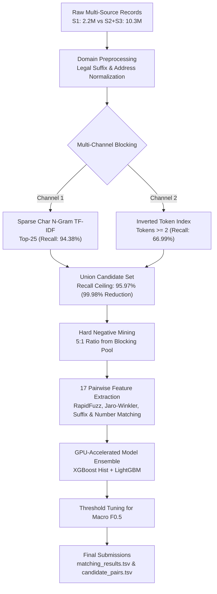

# Amazon ML Challenge: Business Entity Resolution

[](https://www.python.org/downloads/)
[](https://xgboost.ai/)
[](https://lightgbm.readthedocs.io/)
[](https://github.com/maxbachmann/RapidFuzz)
[](https://opensource.org/licenses/MIT)

Entity resolution for the Amazon ML Challenge 2026. For each of 2.2M business records (Source 1), find the matching records in a pool of 10.3M records from two other sources (Sources 2 and 3). Submissions are scored with macro F0.5, which weights precision more than recall, so a false merge costs more than a missed match.

---

## Approach

- **Blocking:** comparing every pair means about 22 trillion comparisons, so candidates are generated first. Two channels are merged: character 3 to 5-gram TF-IDF (top 25 by cosine similarity) and an inverted token index (at least 2 shared name tokens, same country). This cuts comparisons by 99.98% and keeps 95.97% of true matches, measured on 5K validation entities.
- **Preprocessing:** strips legal suffixes and generic qualifiers (`Pvt Ltd`, `LLC`, `GmbH`, transliterated Indic forms) so they do not inflate name similarity. Addresses are normalised (`rd` to `road`) and numbers are extracted.
- **Features:** 17 pairwise features: name similarity (Levenshtein, Jaro-Winkler, token sort and set ratios, Jaccard), legal suffix and prefix compatibility, address similarity, address number overlap, and country match.
- **Training:** negatives are sampled from the blocking candidates (5 per positive), so the model learns from close non-matches. XGBoost (GPU) and LightGBM are trained with class weighting and early stopping, and their probabilities are averaged.
- **Threshold:** swept from 0.20 to 0.85 in steps of 0.05, keeping the value with the best macro F0.5 on the validation sample.

---

## Pipeline Architecture



---

## Results

### Candidate Blocking Comparison (Validation Split)
| Channel | Candidate Strategy | Recall Ceiling | Reduction Ratio | Avg Candidates / Entity |
| :--- | :--- | :---: | :---: | :---: |
| **TF-IDF Channel** | Char 3–5 N-grams, Cosine $\ge 0.08$ | 94.38% | 99.99% | 25.0 |
| **Rule Channel** | Inverted Index, $\ge 2$ Shared Tokens | 66.99% | 99.98% | 1,987.5 |
| **Fused (Union)** | **Multi-Channel Fusion** | **95.97%** | **99.98%** | **2,005.9** |


### Model Result
| Metric | Value |
| :--- | :---: |
| Macro F0.5 (leaderboard) | 0.912 |
| Validation split | 85 / 15 by entity (1,875,797 train, 331,024 validation) |
| Training sample | 30,000 Source 1 entities |
| Blocking evaluation sample | 5,000 validation entities |

### Limitations
- The model was trained on a 30,000-entity sample of the 1.88M available training entities because of Colab and Kaggle memory and time limits. More data may help.
- Validation metrics use a 5,000-entity sample of the validation split.
- No ablation study was run, so the contribution of each feature group and of the ensemble over a single model is not measured.

---

## Repository Structure

```text
├── Documentation.md              # Detailed methodology and error analysis write-up
├── README.md                     # Project documentation and reproduction guide
├── requirements.txt              # Pinned Python package dependencies
├── .gitignore                    # Prevents tracking data, parquets, models, and temp files
│
├── notebooks/
│   ├── Amazon_ML_Challenge_Master.ipynb  # Unified, end-to-end master Jupyter Notebook
│   └── experiments/
│       ├── colab_blocking_experiments.ipynb  # Colab TF-IDF and rule blocking experiments
│       ├── colab_eda_preprocessing.ipynb     # Initial EDA and data inspection
│       └── kaggle_gpu_pipeline.ipynb         # Kaggle GPU training script
│
├── src/                          # Modular pipeline
│   ├── __init__.py
│   ├── config.py                 # Hyperparameters, legal suffix patterns, paths
│   ├── preprocess.py             # Unicode cleaning, legal suffix removal, address parsing
│   ├── blocking.py               # Sparse TF-IDF and inverted token indexing
│   ├── features.py               # 17 pairwise similarity features (RapidFuzz, Jaro-Winkler)
│   ├── dataset.py                # Pair generation & hard negative sampling
│   ├── models.py                 # XGBoost + LightGBM GPU/CPU training & ensembling
│   ├── metrics.py                # Macro F0.5 computation & threshold search
│   └── pipeline.py               # Executable end-to-end pipeline runner
│
└── utils/
    └── validate_submission.py    # Official submission format checker
```

---

## Quickstart

### 1. Clone & Set Up Virtual Environment
```bash
git clone https://github.com/saurabhduhariya/amazon-ml-challenge.git
cd amazon-ml-challenge

python3 -m venv venv
source venv/bin/activate
pip install -r requirements.txt
```

### 2. Dataset Setup
Place the challenge datasets into `student_resource/dataset/`:
```text
student_resource/dataset/
├── train/
│   ├── train_source1.tsv
│   ├── train_source2.tsv
│   ├── train_source3.tsv
│   └── train_ground_truth.tsv
└── test/
    ├── test_source1.tsv
    ├── test_source2.tsv
    └── test_source3.tsv
```

### 3. Run the Pipeline
To run the automated pipeline on a sample of 30,000 entities:
```bash
python3 -m src.pipeline --sample 30000
```

To run the interactive notebook, launch Jupyter:
```bash
jupyter notebook notebooks/Amazon_ML_Challenge_Master.ipynb
```

### 4. Validate Submission Files
Validate generated output files against official competition schema:
```bash
python3 utils/validate_submission.py \
    --matching output/matching_results.tsv \
    --candidate output/candidate_pairs.tsv \
    --test-dir student_resource/dataset/test
```

---

## License
This project is licensed under the [MIT License](LICENSE).
